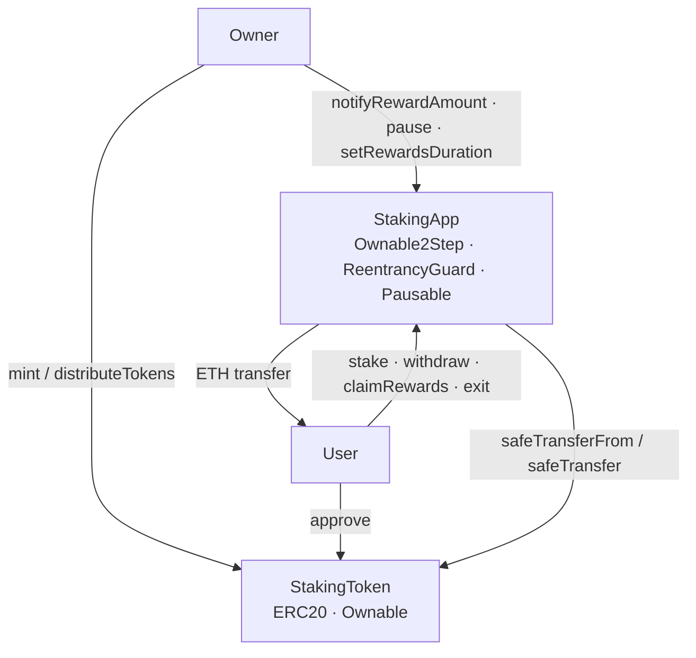
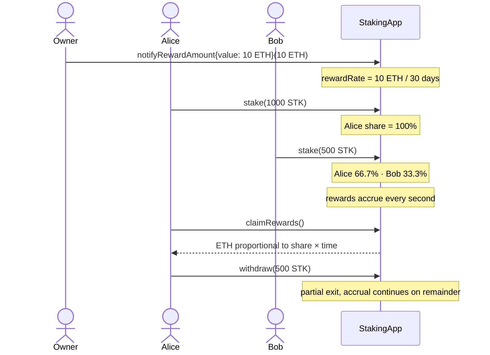

# Staking Continuous Rewards Protocol

A continuous proportional ERC20 staking protocol on Ethereum. Users stake any amount above a configurable minimum and earn ETH rewards that accrue second by second, proportional to their share of the total staked supply. The model follows the Synthetix StakingRewards pattern with ETH as the reward token.


---

## Overview

The protocol consists of two contracts:

- **`StakingToken`** — a mintable ERC20 with a hard cap of 1,000,000 tokens and a batch distribution function for airdrops.
- **`StakingApp`** — accepts flexible token deposits (≥ `minStakingAmount`), tracks each user's share of total supply, and distributes ETH rewards continuously. The owner funds a reward period via `notifyRewardAmount()`, which sets a per-second rate that decays proportionally across all stakers. Partial withdrawals are always available, even when the contract is paused.

## Reward Model

Rewards accrue using a global index (`rewardPerToken`) that advances every second while a funded period is active:

```
rewardPerToken += rewardRate × Δt × 1e18 / totalSupply
earned(user)   = balance[user] × (rewardPerToken − userRewardPerTokenPaid[user]) / 1e18
                 + pendingRewards[user]
```

When the owner calls `notifyRewardAmount()` mid-period, any undistributed ETH rolls into the new rate, preventing reward leakage.

## Example

1. Owner deploys both contracts with a 30-day `rewardsDuration` and a 1 STK minimum stake.
2. Owner mints tokens and calls `notifyRewardAmount{value: 10 ether}(10 ether)` — the contract distributes 10 ETH over 30 days at ~0.00000386 ETH/second.
3. Alice stakes 1000 STK, Bob stakes 500 STK. Alice holds 66.7% of the pool, Bob 33.3%.
4. After 15 days, Alice calls `claimRewards()` and receives ~3.33 ETH (66.7% × 5 ETH elapsed). Her index resets; she continues accruing.
5. Either user can call `withdraw(amount)` at any time for a partial or full exit without forfeiting accrued rewards.
6. `exit()` withdraws all tokens and claims all rewards in one transaction.

## Architecture



### Reward accrual flow



## Key Features

| Feature | Detail |
|---|---|
| Continuous proportional rewards | Rewards accrue every second; each user earns proportional to their share of `totalSupply` |
| Flexible stake amounts | Any amount ≥ `minStakingAmount`; multiple deposits accumulate into one position |
| Partial withdrawals | `withdraw(amount)` accepts any amount up to the user's balance |
| Mid-period refunding | `notifyRewardAmount()` rolls over undistributed ETH into the new rate |
| One-click exit | `exit()` withdraws all tokens and claims all ETH rewards atomically |
| Emergency pause | Owner can pause `stake` and `claimRewards`; `withdraw` is always open |
| Safe token transfers | `SafeERC20` wraps all ERC20 calls |
| Two-step ownership | `Ownable2Step` prevents accidental ownership transfers |
| Typed custom errors | All reverts use Solidity custom errors with parameters |

## Contract Reference

### StakingApp

| Function | Access | Description |
|---|---|---|
| `stake(uint256)` | public · whenNotPaused | Stakes `amount` tokens (≥ `minStakingAmount`); accumulates into existing position |
| `withdraw(uint256)` | public | Returns `amount` staked tokens; always available, even when paused |
| `claimRewards()` | public · whenNotPaused | Transfers all accrued ETH rewards to the caller |
| `exit()` | public | Withdraws full token balance and claims all rewards in one transaction |
| `notifyRewardAmount(uint256)` | onlyOwner · payable | Funds the contract and activates a reward period; rolls over leftover if mid-period |
| `setRewardsDuration(uint256)` | onlyOwner | Updates reward period duration; only callable after current period ends |
| `setMinStakingAmount(uint256)` | onlyOwner | Updates the minimum stake amount |
| `pause() / unpause()` | onlyOwner | Toggles emergency pause |
| `earned(address)` | view | Returns accrued but unclaimed ETH for an account |
| `rewardPerToken()` | view | Returns the current cumulative reward index (scaled 1e18) |
| `lastTimeRewardApplicable()` | view | Returns `min(block.timestamp, periodFinish)` |

### StakingToken

| Function | Access | Description |
|---|---|---|
| `mint(uint256)` | onlyOwner | Mints tokens up to `MAX_SUPPLY` (1,000,000 STK) |
| `distributeTokens(address[], uint256[])` | onlyOwner | Batch transfer for initial distribution |

## Security

| Measure | Where applied |
|---|---|
| CEI (Check-Effects-Interactions) | `withdraw`, `claimRewards`, `exit` — state cleared before external transfer |
| `ReentrancyGuard` | All user-facing functions |
| `SafeERC20` | `stake` and `withdraw` |
| `Ownable2Step` | Ownership transfers require explicit acceptance |
| `Pausable` | `stake` and `claimRewards` gated; `withdraw` intentionally excluded |
| `updateReward` modifier | Snapshots the global index before any balance change to prevent reward manipulation |
| Custom errors with parameters | All reverts — `BelowMinimumStake(minimum, provided)`, `InsufficientBalance(balance, requested)`, etc. |

The reentrancy test includes a purpose-built `ReentrantAttacker` contract that attempts to re-enter `claimRewards` inside the ETH `receive` hook, confirming `ReentrancyGuard` blocks it correctly.

## Testing

53 tests across four suites:

| Suite | Type | Coverage |
|---|---|---|
| `StakingAppTest.t.sol` | Unit — happy path, reverts, access control, pause, reentrancy | `StakingApp`: 100% lines |
| `StakingAppValidationTest` (`StakingAppValidation.t.sol`) | Unit — constructor and duration bounds, reward rate checks, ETH payment failures, exit branches, pause scope | `StakingApp`: 100% lines and branches |
| `StakingTokenTest.t.sol` | Unit — mint, distribute, access control | `StakingToken`: 100% lines |
| `StakingAppFuzz.t.sol` | Fuzz — stake bounds, reward proportionality, monotonicity, withdrawal limits, duration bounds, reward rate | 256 runs per test (5,000 in CI) |
| `StakingAppInvariant.t.sol` | Invariant — token solvency, ETH solvency, rewardPerToken monotonicity, totalSupply consistency | 256 sequences · depth 128 |

CI runs `forge fmt --check`, `forge build --sizes`, `forge test` (profile `ci`, higher fuzz runs), a 95% line-coverage gate on `src/`, `forge snapshot --check` and Slither on every push.

## Security

| Measure | Location |
|---|---|
| Two-step ownership transfer | `Ownable2Step` |
| Reentrancy guard on every state-changing user function | `nonReentrant` |
| CEI: state cleared before ETH and token transfers | `withdraw`, `claimRewards`, `exit` |
| Exit path never paused | `withdraw`, `exit` have no `whenNotPaused` |
| `msg.value` must equal the declared reward | `notifyRewardAmount` (`IncorrectRewardValue`) |
| Rewards that would round the rate to zero are rejected | `notifyRewardAmount` (`RewardRateTooLow`) |
| Rewards duration bounded to 1 to 365 days | constructor, `setRewardsDuration` |
| Custom errors only | `StakingApp.sol` |
| Slither in CI | `slither.config.json` |

See [SECURITY.md](SECURITY.md) for assumptions and known limits.

**Gas (median, production functions):**

| Function | Median gas |
|---|---|
| `stake` | ~179,000 |
| `withdraw` | ~211,000 |
| `claimRewards` | ~334,000 |
| `exit` | ~349,000 |

## Tech Stack

- **Solidity** `0.8.24`
- **Foundry** `1.7.1` — Forge, Anvil, Cast
- **OpenZeppelin Contracts** `v5.7.0` — ERC20, SafeERC20, Ownable2Step, ReentrancyGuard, Pausable
- **forge-std** `v1.17.0`

## Getting Started

**Prerequisites:** [Foundry](https://book.getfoundry.sh/getting-started/installation)

```bash
git clone --recurse-submodules https://github.com/sergiiogg7/staking-continuous-rewards-protocol.git
cd staking-continuous-rewards-protocol
forge build
forge test
```

**Run with gas report:**
```bash
forge test --gas-report
```

**Check gas regressions against snapshot:**
```bash
forge snapshot --check
```

**Deploy locally (requires Anvil running):**
```bash
cp .env.example .env   # fill in values
source .env
forge script script/Deploy.s.sol --rpc-url $RPC_URL --private-key $PRIVATE_KEY --broadcast
```

## Project Structure

```
src/
  StakingApp.sol        # Core staking logic — Synthetix rewards model
  StakingToken.sol      # ERC20 staking asset
script/
  Deploy.s.sol          # Reproducible deployment script
test/
  StakingAppTest.t.sol  # Unit tests
  StakingAppValidation.t.sol  # Validation, payment failures, pause scope
  StakingTokenTest.t.sol
  utils/StakingBase.sol  # Shared setup and non-payable staker mock
  StakingAppFuzz.t.sol  # Fuzz tests
  StakingAppInvariant.t.sol  # Invariant tests with handler
.github/workflows/
  test.yml              # CI: fmt · build · test · coverage · gas snapshot · Slither
.env.example            # Deployment configuration template
```
